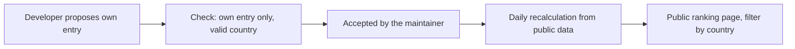

# podio: product overview

Status: Approved (2026-11-26)
Approval: content D5xg7gIHCN91

## Summary

podio is an open ranking of Latin American developers, built from public GitHub activity, for developers who want to be seen and for anyone who wants to find them. A developer appears only after asking, and can leave the same way. It is built live on TikTok, and its categories, countries and page are proposed by its community. The rules that matter most: nobody appears without asking, nobody can add or remove another person, and only public data is counted.

Last change: 2026-11-26, principle 7 updated: community may write issues and pull requests in Spanish or English (D-26)

Decisions not yet absorbed: [DECISIONS.md](DECISIONS.md). Terms: [GLOSSARY.md](GLOSSARY.md).

## 1. Problem

Developers from Latin America have few places to be seen together (REQ-4). A commit total alone says little about who contributes to other people's work, and it favors one style of work (REQ-3). A list that includes people who never asked can expose them (REQ-2). podio asks first and counts more than commits (D-15). The project started as a live stream with an audience and little for the audience to do: a contribution guide (CONTRIBUTING.md) exists, with no outside use yet (REQ-1), and nothing yet gives people a reason to return (REQ-5).

Evidence today (2026-11-25): 1 member (the owner), 20 countries accepted, 0 contributions from other people. No survey or count of how many developers want to be listed: unknown.

Goals in priority order (D-8): (a) a community built live on TikTok, with people from the chat contributing; (b) a showcase for Latin American developers; (c) healthy competition that brings people back to see movement.

## 2. Product

A public web page shows one ranking of members across Latin America, with a filter by country and one view per category. Each day it is recalculated from public GitHub data. Members join and leave by proposing a change to the project's own repository.

A member's country is the one they declare; it is not verified, only checked to be on the list of accepted countries (D-17).

## 3. Users

- **Member:** a Latin American developer who chose to be listed. Wants to be seen and to compare.
- **Visitor:** anyone who opens the page: other developers, recruiters, people from the stream. Reads and filters; does not sign up.
- **Contributor:** a person, often from the stream chat, who proposes a category, a country or a page change. May or may not be a member.
- **Maintainer:** the owner, who accepts proposals and decides the categories.

## 4. Principles

1. **Nobody appears without asking.** A person is listed only through their own proposal.
2. **Only your own entry.** A proposal can add, change or remove only its author's entry; no one acts for someone else.
3. **Public data only.** Counts come from public GitHub data. Private activity counts only when the user chose to show it on their public profile, and then only as the daily count GitHub shows everyone. Counts of work in other people's repositories use public repositories only (D-4).
4. **Many ways to stand out.** No single number decides who is good; each category is a separate ranking (D-3).
5. **The limits are stated.** Where a number can be inflated, the page and the docs say so instead of hiding it (D-9).
6. **Built in the open.** Categories, countries and the page change through proposals anyone can make; the process for proposing is written down.
7. **Spanish for people, English for code.** Everything a visitor reads is Spanish with voseo; code and commits are English; people from the community may write issues and pull requests in Spanish or English (D-7, D-26).

## 5. Use cases

| ID | Name | Description |
|---|---|---|
| UC-1 | Join the ranking | A developer proposes an entry for themselves (GitHub login and country) and appears after the next daily recalculation. Asked in REQ-2. |
| UC-2 | Leave the ranking | A member proposes removing their own entry and disappears after the next recalculation. Asked in REQ-2. |
| UC-3 | See the ranking | A visitor opens the page and sees members ordered in one category, with picture, name, country and value. The first view is contributions of the year (D-12). Asked in REQ-4. |
| UC-4 | Filter by country | A visitor limits the ranking to one country and sees positions within it. Asked in REQ-4. |
| UC-5 | Switch category | A visitor picks another category (contributions of the year, current streak, longest streak, merged pull requests in other people's repositories, stars) and sees that ranking. Asked in REQ-3. |
| UC-6 | Know how fresh and how fair it is | A visitor sees when the data was last calculated and what each category counts, including the known ways to inflate it. Asked in REQ-5. |
| UC-7 | Propose a category or change | A contributor proposes a category, a country or a page change, and the written process tells them what is needed. Asked in REQ-1. |

## 6. Scope

In this version: joining and leaving by one's own proposal; five categories over the last 12 months; one ranking for the whole region with a country filter (D-10); daily refresh; a page that works on a phone; a written process to propose categories. The 20-country list is final for v1; a community proposal may add a country (D-14).

Out: scoring that combines categories; teams or organizations; any private repository data; accounts, login or editing on the page; notifications; ranking history over time; badges for people's own profiles; countries outside the list; any protection against inflated streaks or yearly totals (D-9).

## 7. Slice map

| Slice | Folder | Covers | Use cases |
|---|---|---|---|
| join | `docs/join/` | Entering and leaving by one's own proposal, and the checks that protect consent | UC-1, UC-2 |
| ranking | `docs/ranking/` | What is counted, how it is ordered, the page, the filter, freshness | UC-3, UC-4, UC-5, UC-6 |
| community | `docs/community/` | How outsiders propose categories, countries and page changes | UC-7 |

Order of work: join, ranking, community.

## 8. Success criteria

Indicative targets, not requirements, within 30 days of the first public page (D-13, D-16):

- at least 20 members from at least 5 countries;
- at least 5 merged pull requests from people who are not the owner;
- at least 1 contributor-proposed change merged.

Goal c (people return) has no target in v1 (D-16). podio is a relaxed live-stream activity; nobody is expected to contribute.

## 9. Constraints and facts

| Fact | Effect | Verified |
|---|---|---|
| The GitHub profile contribution graph counts commits only on the default branch, in non-fork repositories, with an email linked to the account | Streaks and yearly totals ignore fork and other-branch work; the page says so | GitHub docs, profile contributions reference, read 2026-11-25 |
| Private contributions appear on a profile only if the user turned on "Private contributions", and then only as anonymous daily counts | Consistent with principle 3; nothing private beyond a count is visible | GitHub docs, showing private contributions, read 2026-11-25 |
| One query covers at most one year of contributions | "Last 12 months" is the natural window | GitHub API reference, read 2026-11-25 |
| New contributions can take up to 24 hours to show | "Fresh" means daily at best | GitHub docs, why contributions are not showing, read 2026-11-25 |
| 20 countries are accepted today | The country list is a product fact (D-14) | `scripts/validate.mjs`, read 2026-11-25 |

## 10. Open questions

None.
