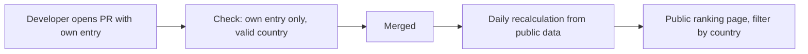

# RESEARCH-01: podio mapped into the Scriptorium chain

Date: 2026-11-25. Author: researcher. Input to builder tasks 2, 3 and 4. Nothing here is approved.

## Summary

podio is an opt-in ranking of LATAM developers by public GitHub activity, built live with its community. This file proposes 5 requests, the PRODUCT.md content, 3 slices (`join`, `ranking`, `community`), 12 decisions for DECISIONS.md and the open questions. Four Owner questions remain, each with a recommendation. Research questions are answered with sources below.

Last change: 2026-11-25, first draft

## 1. Proposed requests

All five: who asked = the owner, 2026-11-25, TikTok LIVE session where podio started. Status for the builder to write: `Open` (only the owner accepts). The quotes below are paraphrased from the README and the owner's decisions; the builder must mark them as such, since no verbatim quote was recorded (do not invent one).

**REQ-1: Build it live with the chat.** The owner wants podio built on a TikTok live, with people from the chat contributing pull requests. Problem behind it: a solo project on a stream has an audience but nothing for the audience to do. Evidence: unknown (first stream, no chat contributions yet). Slice: community.

**REQ-2: Only people who sign up appear.** Existing GitHub country rankings (README claim, not verified in this research) list everyone without asking. The owner wants nobody listed unless they asked, and nobody able to add someone else. Evidence: README "Por que"; unknown number of people who object to being listed. Slice: join.

**REQ-3: More ways to stand out than commit count.** Commit counts are easy to inflate and favor one style of work. The owner wants several rankings: contributions of the year, current streak, longest streak, merged PRs in other people's repos, stars. Evidence: README; streaks and yearly totals can still be inflated (accepted, see D-9). Slice: ranking.

**REQ-4: Showcase LATAM developers.** One ranking of the whole region, with a country filter, so a developer in any LATAM country can be found and a country can be compared. Evidence: 20 countries listed in `scripts/validate.mjs`; one member so far. Slice: ranking.

**REQ-5: A reason to come back.** The owner wants friendly competition: positions that change, so people return to see movement. Problem behind it: a static list is read once. Evidence: unknown. Slice: ranking (daily refresh, visible date of last update).

## 2. Proposed PRODUCT.md content

Title: `# podio: product overview`. Status: Draft.

### Summary (for the builder to paste)

podio is an open ranking of Latin American developers, built from public GitHub activity. A developer appears only after opening a pull request that adds their own entry, and can leave the same way. It is built live on TikTok, and its categories, countries and website are proposed and added by its community through pull requests. The rules that matter most: nobody appears without asking, nobody can add or remove another person, and only public data is counted.

Last change: 2026-11-25, first draft from research

### 1. Problem

Developer rankings by country usually list everyone and do not ask (README claim; not verified, so Q-4 asks the owner to confirm or drop it). Commit totals are easy to inflate and say little about who contributes to other people's work. LATAM developers have few places to be seen together. podio started as a live stream and needs something the audience can do: contribute. Evidence today: 1 member (the owner), 20 countries accepted, 0 external contributions.

### 2. Product

A public web page shows one ranking of members across LATAM, with a filter by country and a tab per category. Each day it recalculates from public GitHub data. Members join and leave through a pull request on the project's own repository.

### 3. Users

- **Member:** a LATAM developer who chose to be listed. Wants to be seen and compare.
- **Visitor:** anyone who opens the page: other developers, recruiters, people from the stream. Reads, filters, does not sign up.
- **Contributor:** a person (often from the stream chat) who proposes a category, a country fix or a web improvement by pull request. May be a member or not.
- **Maintainer:** the owner, who merges pull requests and decides categories.

### 4. Principles

1. **Nobody appears without asking.** A person is listed only through their own pull request.
2. **Only your own entry.** A pull request can add, change or delete only its author's entry; no one acts for someone else.
3. **Public data only.** Counts come from public GitHub data. Private activity counts only when the user chose to show it on their public profile, and then only as the daily count GitHub shows everyone. Pull-request counts use public repositories only.
4. **Many ways to stand out.** No single number decides who is good; each category is a separate ranking.
5. **The limits are stated.** Where a number can be inflated, the page and the docs say so instead of hiding it.
6. **Built in the open.** Categories, countries and the page change through pull requests anyone can open; the process for proposing is written down.
7. **Spanish for people, English for code.** Everything a visitor reads is Spanish (voseo); code, commits and issues are English.

### 5. Use cases

| ID | Name | Description |
|---|---|---|
| UC-1 | Join the ranking | A developer opens a pull request that adds their own entry (GitHub login and country) and appears after the next daily recalculation. |
| UC-2 | Leave the ranking | A member opens a pull request that deletes their own entry and disappears after the next recalculation. |
| UC-3 | See the ranking | A visitor opens the page and sees members ordered in one category, with picture, name, country and value. |
| UC-4 | Filter by country | A visitor limits the ranking to one country and sees positions within it. |
| UC-5 | Switch category | A visitor picks another category (contributions of the year, current streak, longest streak, merged PRs in other people's repos, stars) and sees that ranking. |
| UC-6 | Know how fresh and how fair it is | A visitor sees when the data was last calculated and what each category counts, including the known ways to inflate it. |
| UC-7 | Propose a category or change | A contributor opens an issue to propose a category, or a pull request to change a country list or the page, and the process tells them what is needed. |

### 6. Scope

In this version: opt-in join and leave by pull request; five categories over the last 12 months; one LATAM ranking with country filter; daily refresh; a page that works on a phone; a written process to propose categories. Out: scoring that combines categories; teams or organizations; any private repository data; accounts, login or editing on the page; notifications; ranking history over time; badges for READMEs (candidate community issue, not in v1); countries outside the LATAM list; any protection against inflated streaks or yearly totals (see D-9).

### 7. Slice map

| Slice | Folder | Covers | Use cases |
|---|---|---|---|
| join | `docs/join/` | Entering and leaving by own pull request, and the checks that protect consent | UC-1, UC-2 |
| ranking | `docs/ranking/` | What is counted, how it is ordered, the page, filter, freshness | UC-3, UC-4, UC-5, UC-6 |
| community | `docs/community/` | How outsiders propose categories, countries and page changes | UC-7 |

### 8. Success criteria

Proposed numbers, pending Q-2: within 30 days of the first public page, at least 20 members from at least 5 countries; at least 5 merged pull requests from people who are not the owner (goal a); at least 1 category or page change proposed by a contributor and merged (goal a). Goal b: members from at least 5 countries (same count). Goal c: at least 30% of members have a different position after 14 days (taken from consecutive daily results; requires history, which v1 does not keep, so measure by hand at first). Zero listings of a person by someone else, ever (principle 2).

### 9. Constraints and facts

| Fact | Effect | Verified |
|---|---|---|
| The profile contribution graph counts commits only on the default branch, in non-fork repositories, with an email linked to the account | Streak and yearly totals ignore fork and other-branch work; stated on the page | GitHub docs, profile contributions reference, read 2026-11-25 |
| Private contributions appear on a profile only if the user turned on "Private contributions", and then only as anonymous daily counts | Decision D-4 is consistent with GitHub's own rule; nothing private beyond a count is visible | GitHub docs, showing private contributions; profile contributions reference, read 2026-11-25 |
| In the GraphQL API `restrictedContributionsCount` is non-zero only when the user shared private contribution counts | Same as above, at the data level | GitHub GraphQL reference, Users, read 2026-11-25 |
| Contribution queries cover at most one year (default window is one year) | "Last 12 months" is the natural window | GitHub GraphQL reference, Users, read 2026-11-25 |
| New contributions can take up to 24 hours to show | "Fresh" means daily at best | GitHub docs, why contributions are not showing, read 2026-11-25 |
| 20 countries are accepted today | Country list is a product fact | `scripts/validate.mjs`, read 2026-11-25 |

### 10. Open questions

Copy the Owner questions of section 5 (Q-1 to Q-4) here. Research and Lead questions are answered below and not copied.

## 3. Proposed slices

Folders are not reserved names. Order of work: join, ranking, community.

| Slice | Folder | ID | One line | Covers |
|---|---|---|---|---|
| join | `join` | `JOIN` | Entering and leaving the ranking by own pull request, with the consent rules and the validation message. | UC-1, UC-2; REQ-2 |
| ranking | `ranking` | `RANKING` | What each category counts, order and ties, country filter, the page, freshness and the stated limits. | UC-3, UC-4, UC-5, UC-6; REQ-3, REQ-4, REQ-5 |
| community | `community` | `COMMUNITY` | How a person outside the project proposes and lands a category, a country or a page change. | UC-7; REQ-1 |

Why 3 and not 2: goal (a) is first priority, and the proposal process has its own rules (what a proposal must contain, when it is accepted). Merging it into ranking would hide the owner's top goal. Why not 4: the page and the data are one slice, since a visitor cannot use one without the other.

REQ-1 also shapes principle 6 across all slices. The existing code is not a slice; see L-1.

## 4. Decisions to record in DECISIONS.md

Template columns: ID, Date, Decision, Goes into. Owner decisions are D-n; the lead's calls are L-n. All dated 2026-11-25 (the HANDOFF decisions were taken earlier; the builder records them on the day they enter the chain).

| ID | Date | Decision | Goes into |
|---|---|---|---|
| D-1 | 2026-11-25 | A member entry is the file `members/<login>.json` with the GitHub login and a country code. Only LATAM countries are allowed. | docs/join/PRD.md |
| D-2 | 2026-11-25 | A pull request may add, change or delete only the entry of its author. The check runs in CI against the pull request author. | docs/join/PRD.md |
| D-3 | 2026-11-25 | The categories are: contributions of the year, current streak, longest streak, merged pull requests in other people's repositories, and stars. | docs/ranking/PRD.md |
| D-4 | 2026-11-25 | Only public data is used. Private contributions count if the user chose to show them on their public profile, because that is public data. The pull-request category searches public repositories only. | docs/PRODUCT.md |
| D-5 | 2026-11-25 | Data is recalculated daily and the page is published without committing data to the repository. | docs/tp/TP.md |
| D-6 | 2026-11-25 | The page is static, with no framework and no build step, in the identity of antonygiomarx.dev (colors, fonts, flat 1px borders). | docs/tp/TP.md |
| D-7 | 2026-11-25 | The first member is the owner. Text for users is Spanish with voseo; code, commits and issues are English. | docs/PRODUCT.md |
| D-8 | 2026-11-25 | Goals in priority order: (a) a community built live on TikTok, with people from the chat contributing pull requests; (b) a showcase for LATAM developers; (c) healthy competition that brings people back to see movement. | docs/PRODUCT.md |
| D-9 | 2026-11-25 | Anti-gaming is accepted out of v1. Streaks and yearly contributions can be inflated; the limit is documented and the community proposes better categories later. | docs/ranking/PRD.md |
| D-10 | 2026-11-25 | The main view is one LATAM ranking with a country filter. | docs/ranking/PRD.md |
| D-11 | 2026-11-25 | Commits carry no attribution lines of any kind. | docs/CROSS-CUTTING.md |
| L-1 | 2026-11-25 | The existing uncommitted code is documented by the chain, not rewritten. Known defects from HANDOFF (`member.login` against `github`; PR search without `is:public`; accents) become fix specs on the FRDs once they exist. | docs/ops/ and docs/join, docs/ranking specs |

D-1 to D-7 and D-11 come from HANDOFF "Decisiones tomadas" and "Contexto"; D-8 to D-10 and D-4's second half from the owner's 4 decisions. HANDOFF mentions a rule not to print work-project data on the stream: it is a session rule, not a product decision, and stays out of the chain.

## 5. Open questions

Tags follow the skill: Owner (only the owner can answer), Research (sources answer), Lead (the lead decides and records).

### Owner

- **Q-1 (Owner: product priority).** Which category is the default tab when a visitor opens the page? Recommendation: contributions of the year, because it is the most familiar number and gives everyone a position on day one; the other four are one tap away.
- **Q-2 (Owner: targets are the owner's to set).** Are these success numbers right: 20 members from 5 countries, 5 merged pull requests from non-owners, 1 contributor-proposed change merged, all within 30 days of the first public page? Recommendation: yes, as a floor; they come straight from goals a and b and can be raised later.
- **Q-3 (Owner: product scope).** Is the 20-country list final for v1 (it includes Cuba and Puerto Rico and excludes Spain and Haiti)? Recommendation: keep it as is and let a pull request add a country, as the community-owned process in UC-7.
- **Q-4 (Owner: only the owner knows the claim's source).** The README says existing rankings list a whole country without asking and count only commits. Was that checked? Recommendation: soften the README and PRODUCT problem to "podio asks first and counts more than commits" unless the owner names a ranking; the builder would then drop the unverified claim from PRODUCT section 1.

### Research (answered)

- **R-1. Do private contributions show up with a token that cannot see private repositories?** Only if the user turned on "Private contributions", and only as anonymous daily counts; the API field `restrictedContributionsCount` is non-zero only in that case. Sources: GitHub docs "Showing your private contributions and achievements on your profile"; "Profile contributions reference"; GraphQL reference, Users (`ContributionsCollection`). Gap: the docs do not say in words that `contributionCalendar.totalContributions` includes the anonymous counts, though the profile graph does. The spec for the yearly category must include one test against a real opted-in account before it relies on this. Record as D-4 (done above) with these sources.
- **R-2. Do commits in forks count?** No. Commits count only in standalone repositories, on the default branch or `gh-pages`, with an email linked to the account. Pull requests and issues count only if opened in a standalone repository. Sources: GitHub docs "Why are my contributions not showing up on my profile" and "Profile contributions reference". Effect: state it on the page (UC-6).
- **R-3. What window can a single query cover?** One year; omitting dates gives the last year. Source: GraphQL reference, Users. Effect: the 12-month window needs no pagination of dates.
- **R-4. Is the Spanish "voseo" a risk for the whole region?** Not researched; it is the owner's voice (HANDOFF) and a product choice, so it is D-7, not a question.

### Lead

- **Q-5 (Lead).** Does the existing code count as "adopt" instead of "init"? Answer proposed: use `/scriptorium:init` (there are no product documents, only a handoff and a README) and record L-1. Lead to confirm.
- **Q-6 (Lead).** API rate limits at scale (more than a few hundred members) are a TP concern, not a product one. Lead to confirm that the TP, not PRODUCT, owns it; nothing was verified here.

## 6. What this research did not check

- The README claim about other rankings (Q-4).
- Whether `contributionCalendar.totalContributions` includes anonymous private counts (R-1 gap).
- GraphQL rate limits (Q-6).
- Nothing was run: no tests, no `rank.mjs`, no site opened.
